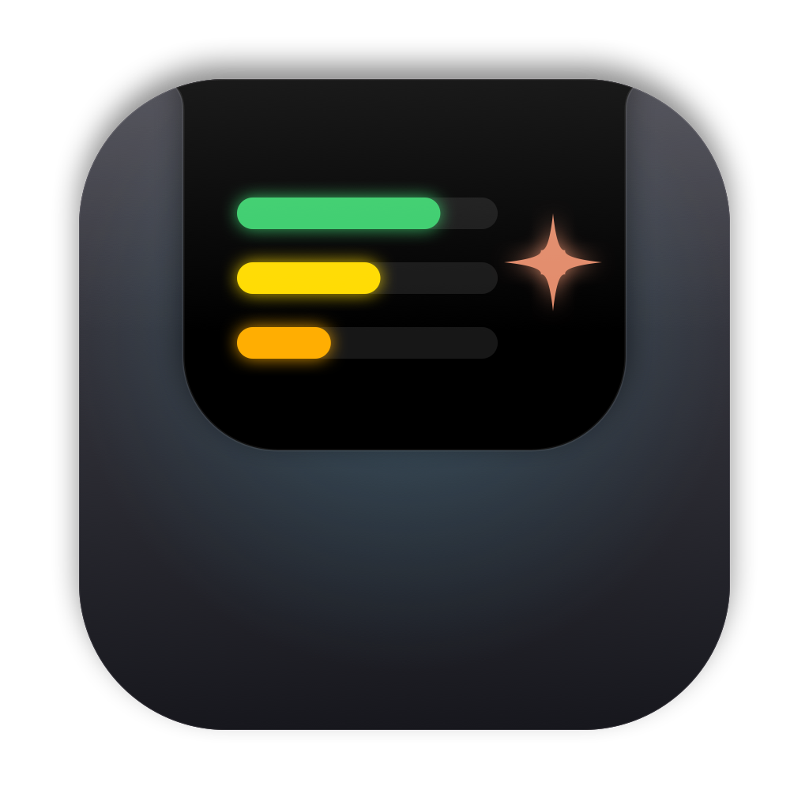

# Notch Panel

Шторка в «чёлке» MacBook в стиле Dynamic Island. Наводишь курсор на чёлку — оттуда плавно выезжает чёрная панель с показателями мака и блоком Claude Code.



## Возможности

- **Анимация как у Dynamic Island** — форма «раздувается» из чёлки на пружине, содержимое проявляется следом; ровно на 120 Гц (анимируется только маска, без пересчёта раскладки).
- **Показатели мака** (сетка 3×2): CPU (% + температура + график за минуту), GPU, память, SSD (занято + чтение/запись), сеть (↓/↑), батарея. Цвет по нагрузке.
- **Вентиляторы и температуры** — по клику на плитку CPU шторка вытягивается вниз: обороты обоих вентиляторов, температура процессора, видеокарты, SSD и батареи с подсветкой 🟢🟡🔴. *Только просмотр* — записи в SMC в коде нет намеренно.
- **Claude Code** — активные сессии (статус, папка, Remote Control → ссылка на claude.ai), токены за сегодня и неделю, кнопки «новая сессия в Терминале» и «открыть приложение Claude».
- **Автозапуск** — переключатель прямо в шторке (`SMAppService`) или служба launchd через `install.sh`.
- В простое ~0,3% CPU: реакция на события мыши, данные обновляются только пока шторка открыта.
- Ничего не отправляет в интернет.

## Требования

- macOS 14 Sonoma или новее, Apple Silicon или Intel.
- Для сборки — только **Command Line Tools** (`xcode-select --install`), Xcode не нужен.

## Сборка и установка

```sh
./build.sh       # собрать build/NotchPanel.app (универсальная: arm64 + x86_64)
./install.sh     # собрать, поставить в /Applications и включить автозапуск (launchd)
./make-dmg.sh    # собрать dist/Notch Panel <версия>.dmg для раздачи
```

После любых правок достаточно `./install.sh` — он пересоберёт, заменит приложение и перезапустит его.

### Отладка без интерфейса

```sh
build/NotchPanel.app/Contents/MacOS/NotchPanel --dump    # показатели мака
build/NotchPanel.app/Contents/MacOS/NotchPanel --fans    # SMC: вентиляторы + температуры
build/NotchPanel.app/Contents/MacOS/NotchPanel --claude  # сессии и токены Claude Code
```

## Устройство кода

| Файл | Что делает |
|---|---|
| `Sources/main.swift` | Точка входа, отладочные флаги, защита от второго экземпляра |
| `Sources/AppDelegate.swift` | Окно-панель над строкой меню, поиск чёлки, отслеживание курсора, анимация раскрытия |
| `Sources/NotchView.swift` | Корневой SwiftUI-вид: форма-маска, шапка, раскладка блоков |
| `Sources/Stats.swift` | Сбор показателей: CPU (`host_processor_info`), память (`host_statistics64`), GPU (`IOAccelerator`), диск (`IOBlockStorageDriver`), сеть (`getifaddrs`), батарея (`IOPowerSources`), температуры (HID-датчики) |
| `Sources/MacStatsView.swift` | Плитки показателей, мини-график, форматирование |
| `Sources/SMC.swift` | Чтение SMC (только чтение): вентиляторы |
| `Sources/FansView.swift` | Блок вентиляторов и температур |
| `Sources/ClaudeModel.swift` | Сессии из `~/.claude/sessions`, токены из журналов `~/.claude/projects` (инкрементально, без дублей) |
| `Sources/ClaudeView.swift` | Карточка Claude Code |
| `Sources/LoginItem.swift` | Переключатель автозапуска |
| `Icon/make-icon.swift` | Рисует иконку кодом → `Icon/AppIcon.icns` |
| `dist-files/` | Файлы, которые кладутся в DMG (инструкция для пользователя) |

## Подводные камни

- **SDK.** В Command Line Tools может лежать SDK новее компилятора Swift (например, SDK 27 при Swift 6.3) — тогда сборка падает. В `build.sh` SDK закреплён: `MacOSX26.sdk`. Если у вас другой набор SDK — поправьте путь.
- **SMC и выравнивание.** Swift упаковывает вложенные структуры плотнее, чем C: в `KeyInfo` нужен явный хвост из 3 байт, иначе драйвер отвечает `kIOReturnBadArgument`.
- **Названия датчиков температуры** зависят от чипа и версии macOS. Сейчас поддержаны: `* ACC MTR Temp*` / `PMU tdie*` (CPU), `GPU MTR Temp*` / `PMU TP*g` (GPU), `NAND*` (SSD), `gas gauge battery` (батарея). Если показывается «—» — посмотрите список датчиков и добавьте свои имена в `TempSensors`.
- **Температуры** читаются через закрытый HID-интерфейс IOKit (как в бесплатных мониторах). На Intel он недоступен — там будет «—».
- **Gatekeeper.** Приложение подписано ad-hoc, без Developer ID и нотаризации. На чужом маке его нужно один раз разрешить: Системные настройки → Конфиденциальность и безопасность → «Всё равно открыть» (подробно — в `dist-files/Как установить.txt`).
- Идентификатор приложения — `com.myami.notchpanel` (в `Info.plist`, `install.sh`, `LoginItem.swift`, `main.swift`).
